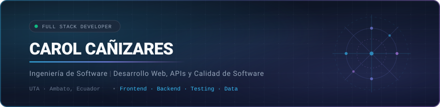

 

**Estudiante de Ingeniería de Software · Universidad Técnica de Ambato · Ecuador**

*«De la idea al código. Del código a la solución.»*

---

### 👩‍💻 Sobre mí

Soy **Carol Cañizares**, estudiante de Ingeniería de Software y desarrolladora **Full Stack**. Me interesa construir aplicaciones web útiles, desde interfaces intuitivas hasta servicios backend y bases de datos bien estructuradas.

- 💻 Desarrollo de aplicaciones web y APIs REST.
- 🧩 Interés en arquitectura de software, calidad y pruebas automatizadas.
- 🗄️ Experiencia académica con bases de datos relacionales y NoSQL.
- 🚀 Aprendizaje continuo y trabajo colaborativo con Git y GitHub.

### 🛠️ Tecnologías y herramientas

**Frontend**

    

**Backend**

    

**Bases de datos**

  

**Herramientas y calidad**

   

### 🚀 Proyectos destacados

| Proyecto | Descripción | Repositorio |
| :--- | :--- | :--- |
| **🦁 Wild Store** | Mascota virtual interactiva desarrollada con JavaScript, HTML y CSS; aplica patrones de diseño como State, Strategy y Observer. | [Ver código](https://github.com/carol104/Wild-Store) |
| **💳 Simulador de Crédito** | Solución de simulación de créditos con estructura de proyectos de aplicación, dominio, infraestructura e interfaces .NET/Blazor. | [Ver código](https://github.com/carol104/SimuladorCredito) |
| **🎓 Sistema de Docentes** | Proyecto de software relacionado con gestión docente, desarrollado en una solución .NET. | [Ver código](https://github.com/carol104/SistemaDocentesProyecto) |

> **Nota:** Los proyectos son parte de mi portafolio académico y de desarrollo. Consulta cada repositorio para conocer su alcance y estado.

### 📊 Actividad en GitHub

> Las estadísticas se obtienen de servicios externos y pueden tardar en cargar o estar temporalmente indisponibles. Los lenguajes representan los repositorios analizados, no una evaluación de dominio técnico.

### 🤝 Contacto

¿Quieres conversar sobre desarrollo de software, proyectos o colaboración?

- 💼 [LinkedIn](https://www.linkedin.com/in/carol-ca%C3%B1izares-villac%C3%ADs-1518833ba/)
- 🧑‍💻 [GitHub](https://github.com/carol104)

---

**Gracias por visitar mi perfil. ✨**

