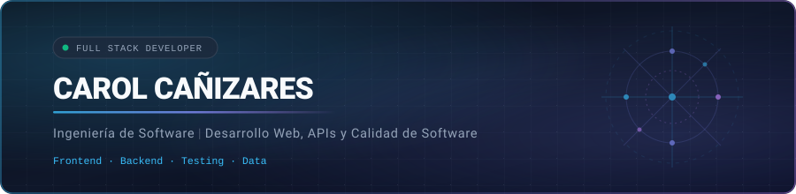

  

 

**Estudiante de Ingeniería de Software**

---

## Sobre mí

Estudiante de Ingeniería de Software enfocada en desarrollo Full Stack, construcción de servicios y APIs robustas, aseguramiento de la calidad mediante pruebas automatizadas y análisis de datos. 

Trabajo con metodologías ágiles y control de versiones orientado a buenas prácticas, diseño modular y mantenibilidad del software.

---

## Stack tecnológico

#### Lenguajes

#### Frontend

#### Backend

#### Aplicaciones de escritorio

#### Bases de datos

#### Calidad y pruebas

#### CI/CD y despliegue

#### Arquitectura y desarrollo

#### Datos y análisis

#### Administración e integración de datos

#### Herramientas de desarrollo

#### Inteligencia artificial

#### Gestión y colaboración

#### Sistemas y seguridad

---

## Proyectos destacados

| Proyecto | Descripción | Enlace |
| :--- | :--- | :--- |
| **Wild Store** | Mascota virtual interactiva construida con JavaScript, HTML y CSS aplicando patrones de diseño (State, Strategy y Observer). | [Repositorio](https://github.com/carol104/Wild-Store) |
| **DinoPet** | Simulación y juego de mascota virtual enfocado en mecánicas de interacción y gestión de estados. | [Repositorio](https://github.com/carol104/DinoPet) |
| **ReciclApp** | Aplicación orientada a la gestión, clasificación y fomento del reciclaje y la sostenibilidad. | [Repositorio](https://github.com/carol104/ReciclApp) |
| **UTAPost** | Aplicación móvil para difusión, publicaciones y gestión informativa en la comunidad universitaria. | [Repositorio](https://github.com/carol104/UTAPost-Movil) |

---

## Actividad en GitHub

 

 

---

## Contacto

- **LinkedIn:** [carol-cañizares-villacís](https://www.linkedin.com/in/carol-ca%C3%B1izares-villac%C3%ADs-1518833ba/)
- **GitHub:** [@carol104](https://github.com/carol104)
